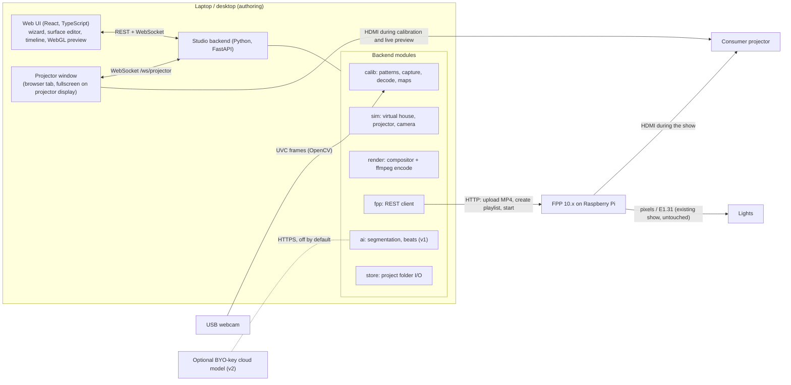

# 02 – Architecture and key decisions

Working name: **FacadeKit**. Read `docs/01-landscape.md` for the research behind these choices. Evidence tags: **[V]** verified against a source there, **[A]** assumption with a spike in `docs/03-roadmap.md`.

## 1. One-paragraph summary

FacadeKit **Studio** is a program the decorator runs on a laptop. It is a local Python server plus a web UI in the browser. Studio shows patterns through the projector, watches them with a USB webcam, and builds a photo of the house *as the projector sees it*. The user marks surfaces on that photo, places media on them along an audio timeline, and clicks Render. Studio writes one ordinary H.264 MP4 whose pixels are already warped and masked for that projector position, uploads it to the user's Falcon Player (FPP) over FPP's REST API, and creates a playlist. From then on the Pi plays a normal video. FPP needs no modification.

## 2. System diagram



During calibration and editing the projector's HDMI cable is in the laptop. For the show it is in the Pi. v1 adds a mode where the Pi shows the patterns so the cable never moves (see §4.9).

## 3. Component list

| Component | Language | Runs on | Responsibility |
|---|---|---|---|
| `studio/backend` | Python 3.11+ | Laptop | HTTP/WebSocket API, job runner, all modules below |
| `calib` | Python + NumPy + OpenCV | Laptop | Gray-code pattern generation, capture orchestration, decoding, projector↔camera maps, projector-view photo, quality report |
| `devices` | Python + OpenCV | Laptop | `Camera` and `ProjectorDisplay` abstractions with real and simulated implementations |
| `sim` | Python + NumPy + OpenCV | Laptop, CI | A virtual house, projector and camera so every algorithm is testable without hardware |
| `render` | Python + NumPy + OpenCV + ffmpeg binary | Laptop | Authoritative compositor: turns a project into frames and an MP4 |
| `fpp` | Python + httpx | Laptop | FPP REST client: probe, upload, playlist, start/stop, status |
| `ai` (v1) | Python + onnxruntime + librosa | Laptop | Click-to-segment, beat/onset detection |
| `store` | Python + pydantic | Laptop | Project folder read/write, schema validation, migrations |
| `studio/web` | TypeScript + React + Vite | Browser | Setup wizard, surface editor, timeline, WebGL preview, projector window page |
| `fpp-plugin` (v2) | PHP + shell (FPP script plugin) | Pi | Optional: menu entry in FPP, Pi-side helpers for deeper integration |
| FPP | – | Pi | Playback, scheduling, playlists, audio, lights. Not modified. |

## 4. Calibration pipeline

### 4.1 The central idea (read this first)

Every pixel the projector emits travels along a fixed ray and lands on some point of the house. If we know *what the house looks like from the projector's position*, then drawing on that picture is the same as drawing on the house. We call this picture the **projector view**, and its pixel grid (for example 1920×1080) is **projector space**.

The webcam is only a measuring tool for building the projector view. Structured light tells us, for each camera pixel, which projector pixel lit it. We use that to re-sample the camera's photo into projector space.

Consequences:

- **No projector intrinsics, lens-shift data, or 3D reconstruction are needed.** We never compute where anything is in 3D.
- **Uneven surfaces (brick, siding) need no special handling for placement.** From the projector's own viewpoint, depth variation does not move a pixel sideways. Depth only matters for a viewer standing far off the projector's axis, and no single correction can fix that for all viewers.
- A **surface** is a shape drawn in projector space. A rectangular real-world object (garage door, window) appears there as a general quadrilateral. Mapping a rectangular video onto that quad is a **homography** (a 3×3 perspective transform) computed from its four corners.
- Mesh warp is an optional per-surface refinement (v1) for objects that are not flat. Per-pixel "audience-view" correction, where content looks undistorted from the street rather than from the projector, is v2.

### 4.2 Physical setup the wizard asks for

1. Projector in its final position, powered on for at least 2 minutes, keystone and digital zoom **off** (digital keystone throws away pixels and changes if the projector resets).
2. Projector's HDMI in the laptop. The laptop's display mode for the projector must be the projector's native resolution (default 1920×1080 at 60 Hz).
3. Webcam on a tripod or taped down, **as close to the projector lens as practical**, seeing the whole projected area with some margin. Close placement keeps parallax and shadow holes small.
4. Dusk or night. Porch lights off if possible.

### 4.3 Pattern set

Gray code with inverse patterns, columns then rows.

- `W, H` = projector resolution. `bits_x = ceil(log2(W))`, `bits_y = ceil(log2(H))` (11 and 11 for 1920×1080).
- `skip_lsb = 2` by default: the two finest bit planes are not projected. Cheap webcams cannot resolve 1–2 px stripes, and a wrong fine bit is worse than a missing one. Decoded coordinates are therefore quantised to 4 px cells. The later fitting steps average thousands of points, so final accuracy is sub-pixel on flat surfaces.
- Frame order: `BLACK`, `WHITE`, then for axis in (`x`, `y`), for bit from most significant down to `skip_lsb`: `pattern`, `inverse`.
- Count for 1080p: `2 + 2·(9 + 9) = 38` frames. At about 0.6 s per frame the scan takes roughly 25 s.

Pattern pixel rule (axis x, bit `b`, projector column `c`): `g = c ^ (c >> 1)`; pixel is white if `(g >> b) & 1` else black. The inverse swaps white and black.

### 4.4 Capture

```
pre-checks:
  projector window reports width*dpr == W and height*dpr == H     else FAIL "resolution mismatch"
  show WHITE; read camera for 5 s; brightness must change < 2 % over the last 2 s
                                                                  else WAIT "projector warming up"
  lock camera: auto-exposure off, auto-white-balance off, autofocus off (best effort; log what failed)
  exposure search: lower exposure until the 99th percentile of WHITE < 250 (not clipped)
  show BLACK, capture; show WHITE, capture
  contrast = WHITE - BLACK  (grayscale float32)
  lit = contrast > max(12, 0.15 * percentile(contrast, 95))
  if area(lit) < 5 % of the camera frame                          -> FAIL "camera does not see the projection"
  if median(contrast[lit]) < 20                                   -> FAIL "too much ambient light"

for each pattern frame:
  send to projector window; wait for its ack (it acks after 2 animation frames)
  sleep settle_ms (default 300)
  grab and discard 5 camera frames (flushes the driver buffer)
  capture 3 frames, convert to grayscale float32, average
```

Why average 3 frames with exposure near 1/30 s: single-chip DLP projectors flash colours in sequence and cheap webcams have rolling shutters, which produces banding in single short exposures.

### 4.5 Decode

```
for axis in (x, y):
  value_gray = 0
  conf = +inf
  for bit b (MSB first):
    d = I[axis][b].pattern - I[axis][b].inverse
    bitval = d > 0
    conf = min(conf, abs(d) / max(contrast, 1))
    value_gray = (value_gray << 1) | bitval
  value = gray_to_binary(value_gray)            # v ^= v>>1; v ^= v>>2; v ^= v>>4; v ^= v>>8
  coord[axis] = (value << skip_lsb) + (1 << skip_lsb) / 2      # centre of the 4 px cell
valid = lit & (conf_x > 0.10) & (conf_y > 0.10) & (coord_x < W) & (coord_y < H)

# outlier rejection
for each valid camera pixel p:
  m = median of coord over valid pixels in the 5x5 window around p
  if |coord[p] - m| > 8 px in x or y: valid[p] = False

c2p = stack(coord_x, coord_y) with NaN where not valid         # shape (Hc, Wc, 2) float32
```

### 4.6 Build the projector view

We need the inverse lookup: for each projector pixel, which camera pixel sees it.

```
G = max(8, 2 * 2**skip_lsb)                  # grid step in projector pixels
gw, gh = W // G + 1, H // G + 1
w_pix = 1 / (1 + (|grad log(contrast)| / 0.05)^2)   # low next to reflectance edges (see below)
for each decoded block b (camera pixels with the same decoded projector coordinate p_b):
  centroid_b = mean (u, v) of its pixels; weight_b = sum of w_pix over its pixels
  i, j = round(p_b.y / G), round(p_b.x / G)                       # nearest node
measured = node has at least one block

# global model, used for sanity, as a weak prior on local slopes and for filling big holes
H_c2p, inliers = cv2.findHomography(cam_pts, proj_pts, RANSAC, 6.0)     # from a random 20k subset
planarity = inlier fraction

# node value: weighted local affine fit  centroid = c + J (p_b - node)  over the blocks of the
# 5x5 nodes around it (Gaussian sigma 1 node), J pulled weakly towards H_c2p's slope; grid = c
# fill holes (nodes with no block within 2 nodes)
small holes: normalized convolution (Gaussian sigma = 2 cells) of grid*fitted / fitted,
             accepted where the blurred weight > 0.05
remaining holes: inverse(H_c2p) applied to the cell's projector coordinate
grid = 3x3 median filter of grid
p2c = bilinear upsample of grid to (H, W, 2) float32
proj_view = cv2.remap(WHITE colour photo, p2c[...,0], p2c[...,1], INTER_LINEAR)
coverage = mean(measured)
```

Why the weights: next to a strong reflectance edge (a dark door frame on a light wall, mortar lines) the camera blurs albedo x stripe, so every stripe edge's zero crossing moves towards the darker side by about `sigma_psf^2 * |grad log albedo|` (0.5-1 projector px for a 1 px camera blur). No per-pixel decision can undo that. The white-minus-black image is the blurred albedo times smooth light, so its log-gradient marks the biased pixels without knowing the blur, gamma or wall. Weights are per decoded block, not per pixel: uneven weights inside a block would move its centroid. Details and numbers: `docs/07-scan-memory.md`, "Albedo-edge bias in the projector map".

Outputs stored per calibration: `p2c.npy`, `measured_mask.png` (upsampled `measured`), `proj_view.png`, `calibration.json` (settings, `coverage`, `planarity`, `H_c2p`, camera resolution, warnings).

Quality gates: `coverage < 0.50` fails. `0.50–0.85` passes with a warning and the UI tints unmeasured areas red on the projector view.

### 4.7 Homography vs per-pixel vs mesh: when each is used

| Mapping | Where | Why |
|---|---|---|
| Dense per-pixel map (`p2c`) | Only to build the projector-view photo | It is a measurement aid. Content never passes through it in MVP/v1, so its noise never appears on the house. |
| Homography per surface | Placing rectangular content on each quad surface (MVP) | Exact for flat surfaces, 8 numbers, trivially editable by dragging 4 corners, identical math in the WebGL preview and the Python renderer. |
| Mesh warp per surface | Optional refinement (v1) for bowed or stepped surfaces | A grid of control points offsets the homography result. Edited by hand while watching the house. |
| Per-pixel audience-view correction | v2 | Uses `p2c` with the camera at the audience position. Needs a clean dense map, so it waits for field data. |

### 4.8 Multi-surface handling and fine alignment

- The user draws any number of surfaces on the projector view. Each is a **quad** (4 corners, order TL, TR, BR, BL as seen on the house) plus an optional **mask polygon** with optional holes, both in projector pixels.
- Each surface has an `aspect` (real-world width ÷ height). Default is estimated from the quad: mean of top and bottom edge lengths divided by mean of left and right edge lengths. The user can type the real value. It is needed for "fit" and "fill" content placement because true aspect cannot be recovered from a perspective quad without projector intrinsics.
- A built-in surface with id `canvas` covers the whole projector frame.
- **Fine alignment**: while the projector cable is still in the laptop, the projector window draws every surface outline live. Dragging a corner in the UI, or nudging with arrow keys (1 px, Shift = 10 px), moves the line on the real house. This removes residual calibration error and is also the complete fallback when the scan fails: the user can draw surfaces blind on a blank canvas and align by eye, as in HeavyM.
- v1 adds click-to-segment: click an object on the projector view and get a mask polygon and a fitted quad.

### 4.9 Re-calibration and drift

Things that move the picture: someone bumps the projector, the mount sags, the projector is taken in for rain and put back.

- **Detect** (manual in v1): the wizard's "Check alignment" publishes and plays a 20 s outline video through FPP.
- **Quick re-align (v1)**: re-run the scan (about 25 s). Compute a homography `H_drift` between the old and new projector views using AKAZE features with RANSAC. A pure rotation of the projector about its lens is exactly a homography, and small translations at house distances are close to one. Apply `H_drift` to every surface's quad, mask and mesh, show outlines for confirmation, then re-render. Media, timeline and masks are untouched.
- **Full redo**: if fewer than 30 inlier matches or reprojection error above 4 px, tell the user to re-draw or fine-align by hand.
- **Pi-driven calibration (v1)**: Studio renders the pattern sequence as a video with each pattern held for 1 s and a start marker of three white/black flashes, uploads it to FPP and plays it. The camera records continuously and Studio finds frame boundaries from the flashes and brightness transitions (self-clocked), so no network timing is needed. Benefit: the HDMI cable stays in the Pi and the scan sees exactly the Pi's output scaling.

### 4.10 Failure modes and user-facing recovery

| Failure | How detected | Message and recovery |
|---|---|---|
| Laptop is not outputting native resolution, or OS display scaling is on | Projector window `innerWidth·devicePixelRatio ≠ W` | "Your computer is sending 1280×720 to the projector. Set the projector display to 1920×1080 and 100 % scaling." Link to per-OS steps. |
| Projector still warming up | WHITE brightness drifts > 2 % | "Projector is warming up. Waiting…" auto-continues. |
| Too much ambient light | median contrast < 20 | "It is too bright to scan. Try again after sunset or turn off nearby lights." Offer manual mode. |
| Camera cannot see the projection | lit area < 5 % | Show the live camera view with the detected lit area outlined: "Move the camera so the whole white rectangle is inside the picture." |
| Camera clipped / auto-exposure pumping | 99th percentile ≥ 250 after exposure search, or WHITE brightness varies between captures | "Lower the camera exposure" with a slider; fall back to more averaging. |
| Part of the facade is hidden from the camera (tree, shadow) | coverage 0.50–0.85 | Red tint on unmeasured areas: "The camera could not see these areas. Surfaces there may need manual alignment." |
| Scan mostly failed | coverage < 0.50 | "Scan failed." Offer: retry, move camera closer to projector, or manual mode. |
| Wind moves a prop during the scan | Local outliers, low confidence | Rejected by the median test and filled by smoothing. Guidance: do not map onto things that move; mask them out. |
| Camera or projector bumped during the scan | Global homography inliers < 30 % with normal contrast | "Something moved during the scan. Scan again." |
| Dark or glossy materials (black shutters, windows) | Low contrast patches | Holes are filled from neighbours. Windows usually need projection material anyway; docs explain. |
| Playback on the Pi is shifted versus the laptop preview | User sees outline video misaligned | Cause: Pi outputs a different HDMI mode or the projector applies overscan. Recovery: set FPP's HDMI mode to native, disable projector overscan, or use Pi-driven calibration (v1). |

## 5. Sequencer / editor

### 5.1 Stack

- **Web UI**: TypeScript, React 18, Vite, Zustand for state, plain CSS modules. Timeline is custom DOM/canvas (no heavy timeline library; the model is simple). Waveform drawing is custom canvas code (v1, T-103); no waveform library. Preview compositing in WebGL2 written directly (one textured-quad shader; no engine).
- **Backend**: Python 3.11+, FastAPI, uvicorn, pydantic v2, NumPy, `opencv-python-headless`, `imageio-ffmpeg` (ships an ffmpeg binary), httpx.
- The web bundle is built to static files and served by the backend, so the user runs one program and opens `http://localhost:8137`.

Web UI is preferred by the owner and also lets a phone on the same Wi-Fi act as a remote for fine alignment in the yard (v1).

### 5.2 Data model (summary; exact schemas in `docs/05-interfaces.md`)

A project is a folder `<name>.fkproj/` holding `project.json` plus media, calibration and render files.

- `projector`: `width`, `height`, `fps` (default 1920, 1080, 30).
- `surfaces[]`: `id`, `name`, `quad` (4 points), optional `mask` (polygon + holes), `feather_px`, `aspect`, optional `mesh` (v1).
- `assets[]`: imported files (`video`, `image`, `audio`) with probed metadata.
- `timeline`: `duration_ms`, optional `audio_asset_id`, `tracks[]`, each with `clips[]`. A clip puts one asset (or a built-in generator in v1) on one surface for a time range, with `fit`, `opacity`, `fade_in_ms`, `fade_out_ms`, `blend`, `loop`, `in_offset_ms`.
- `markers[]`: beat/onset times (v1) used for snapping.
- All times are **integer milliseconds**. Frame `n` of the output has time `t_ms = floor(n * 1000 / fps)`.

### 5.3 Timeline and audio sync

- The timeline's clock is the audio element's `currentTime` when audio exists, otherwise `performance.now()`. The preview draws whatever is active at that time on each animation frame, so preview video can drop frames but never drifts from audio.
- Preview video clips are `<video>` elements uploaded as WebGL textures, seeked to `in_offset + (t − start)` and corrected when they drift more than 80 ms.
- The preview is **approximate**. The authoritative picture comes from the backend: `GET …/frame?t_ms=` returns the exact composited frame, and the UI shows it when playback is paused.
- Live preview on the house: the projector window runs the same WebGL compositor fullscreen at native resolution.
- Sync with lights: the rendered MP4 contains the show audio starting at time 0. If the user's xLights sequence uses the same audio file, an FPP playlist entry of type `both` (sequence + this video as media) keeps lights and projection together [A, spike S-1].

## 6. Render / export path into FPP

### 6.1 Decision: bake the warp into the video

FPP 10 has fit/fill/stretch scaling only, and its own docs list crop and position controls as deferred work [V]. A Pi 3 cannot run a custom shader inside FPP's GStreamer/KMS pipeline without modifying FPP. So the warp, masks and compositing are rendered offline into the file. FPP plays it like any other video.

Cost of this choice: moving the projector means re-rendering. Mitigation: projects keep unwarped sources, quick re-align updates all surfaces at once, and rendering runs faster than real time on a laptop.

### 6.2 Compositing rules (authoritative)

For output frame `n` at `t_ms`:

1. Start with an opaque black RGB frame, `W×H`.
2. For each track from index 0 upward, for each clip with `start_ms ≤ t_ms < start_ms + duration_ms`:
   1. Source time `s = in_offset_ms + (t_ms − start_ms)`. If `loop`, `s = s mod asset.duration_ms`. If not looping and `s ≥ asset.duration_ms`, hold the last frame. Images ignore `s`.
   2. Source rectangle from `fit` and the surface `aspect`: `stretch` uses the whole source; `fill` centre-crops the source to the surface aspect; `fit` uses the whole source and shrinks the destination rectangle inside the surface (letterbox, transparent bars).
   3. `Hs = getPerspectiveTransform(source rect corners → destination corners in projector space)`. Destination corners are the surface quad, or the letterboxed sub-quad computed by mapping the unit square through the quad's homography.
   4. Warp the source with `Hs` to `W×H`, bilinear. If a mesh is present, apply it after the homography (v1).
   5. Alpha `a = source alpha (1 if none) × surface mask × clip opacity × fade(t)`. The mask is the surface's polygon (or its quad if no mask) rasterised with anti-aliasing and blurred with Gaussian sigma `feather_px / 2`. `fade` ramps linearly over `fade_in_ms` and `fade_out_ms`.
   6. Blend onto the frame: `normal`: `dst = src·a + dst·(1−a)`; `add`: `dst = min(1, dst + src·a)`; `screen`: `dst = 1 − (1−dst)(1−src·a)`.
3. Blending is done on gamma-encoded sRGB values (no linearisation). This matches what the WebGL preview does by default and what users expect from video editors.

### 6.3 Encoding presets

| Preset id | Video | Audio | Target | Status |
|---|---|---|---|---|
| `pi3-1080p30` (default) | H.264 High profile, level 4.0, 1920×1080, 30 fps constant, yuv420p, CRF 20, maxrate 8 Mbit/s, bufsize 16 Mbit/s, keyframe every 30 frames, 2 B-frames | AAC-LC 48 kHz stereo 192 kbit/s | Pi 3, 4, 5 | Limits are [A]; spike S-2 confirms on a Pi 3 |
| `pi3-720p30` | Same but 1280×720, maxrate 5 Mbit/s | same | Fallback if S-2 shows 1080p underruns | [A] |
| `preview-540p` | 960×540, CRF 28, `ultrafast` | same | Quick check on the laptop | – |

Container: MP4 with `+faststart`. If the timeline has no audio asset, a silent AAC track is still written so FPP's player always sees an audio stream [A: harmless either way].

Projector native resolution other than 1080p (many cheap projectors are 1280×720 or 800×480 native while accepting 1080p input): the wizard asks for the *native* resolution and calibration, authoring and export all use it.

### 6.4 Publish to FPP

```
probe:   GET  http://{host}/api/fppd/version          -> require majorVersion >= 10
         GET  http://{host}/api/system/info           -> show platform and model to the user
upload:  POST http://{host}/api/file/videos           -> chunked upload session   [dir name A, spike S-1]
         PATCH http://{host}/api/file/videos  (headers Upload-Name, Upload-Offset, Upload-Length), 8 MiB chunks
verify:  GET  http://{host}/api/media/{name}/duration
playlist:POST http://{host}/api/playlist/{playlistName}
         body {"name":…, "mainPlaylist":[{"type":"media","enabled":1,"playOnce":0,
                "mediaName":"<file>.mp4","videoOut":"--Default--"}], "playlistInfo":{…}}   [entry shape A, spike S-1]
start:   POST http://{host}/api/playlist/{playlistName}/start     (optional)
status:  GET  http://{host}/api/fppd/status
```

File names sent to FPP are sanitised to `[A-Za-z0-9._-]` and prefixed `fk_`.

## 7. Device and runtime split

| Work | Where | Why |
|---|---|---|
| Pattern display, camera capture, decoding | Laptop | Needs 1–2 GB RAM for image stacks and a UI; the laptop is already there for editing |
| Editing and preview | Laptop browser | WebGL2 and video decode are free in any 2018+ laptop |
| Rendering and encoding | Laptop | x264 at 1080p30 on a Pi 3 would run at roughly 1–2 fps [A]; a laptop is faster than real time |
| AI models (v1) | Laptop CPU | Small ONNX models; no GPU required |
| Playback, scheduling, audio, light sync | Pi + FPP | What FPP is for. A Pi 3 only has to hardware-decode one 1080p30 H.264 stream. |
| Pattern playback for Pi-driven calibration (v1) | Pi + FPP | It is just another video |
| Deeper Pi integration (v2, owner request) | Pi | Candidates, in order: (1) FPP script plugin that adds a FacadeKit page and an "alignment check" command; (2) webcam on the Pi via FPP 10 video input sources [V they exist] for scheduled drift checks; (3) on-Pi re-render is rejected for Pi 3, possible on Pi 5 |

A browser-only (WASM) build was rejected for now: camera exposure control and long video encodes are unreliable in browsers (ADR-005, ADR-009).

Minimum laptop: 4 cores, 8 GB RAM, any OS with Python 3.11 and Chrome, Edge or Firefox.

## 8. Where AI is used

| Use | Verdict | Approach | Runs | Cost | Milestone |
|---|---|---|---|---|---|
| Camera↔projector calibration | **Not AI.** Structured light is deterministic and more accurate than any learned method on unknown gear. | Gray code | local | 0 | MVP |
| Surface selection | **Real value.** Drawing outlines by hand is the slowest step. | Click-to-segment with MobileSAM (Apache-2.0) exported to ONNX, CPU inference, then polygon simplification and quad fitting | local | 0 | v1 |
| Fully automatic "find all windows and doors" | Modest value; errors need the same manual fixing | Open-vocabulary detector feeding the segmenter | local | 0 | v2 |
| Fitting content to geometry | **Not AI.** It is a homography. | – | – | – | MVP |
| Beat / onset detection | Real value for snapping and auto-cuts. Classical DSP is enough. | `librosa` beat tracking and onset detection | local | 0 | v1 |
| Auto-sequencing a draft show | Useful as a starting point | Rule-based: cut on downbeats, alternate surfaces. Optional BYO-key LLM returns a show plan as JSON validated against our schema. | local, or BYO key | 0, or user's own usage | v2 |
| Generative content fitted to the facade | Real value (it is Illumibot's whole product) but heavy | BYO-key image/video APIs conditioned on the projector-view photo; local diffusion for users with a GPU | BYO key or local GPU | user's own usage | v2 / stretch |
| "AI keystone", chat-driven UI, on-Pi inference | **Hype.** Skipped. | – | – | – | – |

BYO-key design rule: one provider interface, keys stored only in the user's local config file, nothing sent anywhere unless the user enables a provider. Default text model id for the Anthropic provider when it is built: `claude-sonnet-5-5`.

Models are downloaded on first use from the project's GitHub Releases with a SHA-256 check, never bundled in the installer.

## 9. Decision log (ADR style)

Each entry: options considered → choice → rationale → risk if wrong.

**ADR-001 Runtime split.** Options: all on Pi; Pi calibrates and laptop edits; laptop does everything except playback. **Choice: laptop does everything except playback** (owner answer Q2). Rationale: Pi 3 has 1 GB RAM and no usable encoder speed; users already own a laptop. Risk: users without a laptop are excluded; revisit with Pi 5 data in v2.

**ADR-002 Bake the warp into the video.** Options: warp at playback via FPP plugin/shader; replace FPP's player; bake offline. **Choice: bake.** Rationale: FPP 10 has no warp stage [V]; baking needs zero changes to FPP and zero Pi GPU work. Risk: re-render on every projector move. Mitigation: quick re-align plus fast render.

**ADR-003 Author in projector space; no projector intrinsics.** Options: full procam calibration with 3D reconstruction; dense per-pixel content mapping from camera space; projector-space authoring with per-surface homographies. **Choice: projector-space authoring.** Rationale: needs no intrinsics, no checkerboard, robust to bad webcams, simple math shared by preview and renderer. Risk: content looks correct from the projector's position, slightly sheared from far off-axis on deep relief; acceptable for facades.

**ADR-004 Gray code with inverses, skip 2 LSBs.** Options: phase shift (needs linear response and fine sinusoids); ArUco/checkerboard grids (sparse); binary Gray code. **Choice: Gray code + inverse.** Rationale: robust to unknown gamma, auto-exposure residue, textured brick. Risk: 4 px quantisation; mitigated by fitting.

**ADR-005 Camera through the backend (OpenCV), not the browser.** Options: `getUserMedia` in the browser; OpenCV `VideoCapture` in Python. **Choice: OpenCV.** Rationale: exposure/white-balance/focus locking and uncompressed frames. Risk: OpenCV camera property support differs per OS backend. Mitigation: best-effort locking with logged results, frame averaging, simulator tests; phone-as-camera via browser is a v2 option.

**ADR-006 Projector output is a fullscreen browser page.** Options: native window (SDL/GLFW) from Python; browser page on the projector display. **Choice: browser page.** Rationale: no native GUI dependency, works on all OSes, and the same page gives live preview on the house. Risk: OS scaling could resample patterns. Mitigation: the page verifies physical pixel size and draws with `image-rendering: pixelated`; the wizard blocks on mismatch.

**ADR-007 Implement Gray code ourselves.** Options: `cv2.structured_light` (contrib only); own NumPy code. **Choice: own code.** Rationale: avoids `opencv-contrib-python` (bigger, conflicts with headless wheels), and we need custom LSB skipping and confidence anyway. Risk: bugs; mitigated by simulator round-trip tests.

**ADR-008 Python backend + React web UI.** Options: Electron + Node; Tauri + Rust; C#/.NET desktop; Python + web. **Choice: Python + web.** Rationale: OpenCV/NumPy/ONNX ecosystem, easiest for Sonnet/Haiku to write and test, web UI preferred by owner. Risk: packaging Python for non-technical users. Mitigation: ADR-019.

**ADR-009 Authoritative render in Python; WebGL preview is approximate.** Options: render in the browser with WebCodecs; ffmpeg filter graph only; Python frame loop piping to ffmpeg. **Choice: Python frame loop.** Rationale: deterministic, unit-testable with golden frames, supports masks/mesh/generators that ffmpeg filters cannot express. Risk: two compositors can disagree. Mitigation: tiny, exactly specified compositing model (§6.2), a pixel-comparison test between preview and backend on fixed scenes, and exact-frame fetch when paused.

**ADR-010 H.264 High@4.0 1080p30 MP4 + AAC.** Options: H.265; 1080p60; MPEG-2. **Choice as stated.** Rationale: only codec with hardware decode on Pi 3 [A]; software-decodable on Pi 5. Risk: Pi 3 underruns at 1080p. Mitigation: `pi3-720p30` preset and spike S-2.

**ADR-011 Integrate with FPP through REST only (MVP, v1).** Options: FPP plugin; write into the SD card; REST. **Choice: REST.** Rationale: verified, version-discoverable, nothing to install on the Pi. Risk: API changes between FPP majors. Mitigation: one client module, version probe, contract tests against a fake and a real FPP.

**ADR-012 Project = folder with `project.json`; integer milliseconds.** Options: SQLite; single zip; folder. **Choice: folder.** Rationale: inspectable, diff-able, media stays as files. Integer ms avoids float drift. Risk: users move files by hand; mitigated by relative paths and validation on open.

**ADR-013 Simulator-first.** Options: test on hardware only; build a simulator. **Choice: simulator** implementing the same `Camera` and `ProjectorDisplay` interfaces. Rationale: builder models and CI have no projector. Risk: simulator is too kind. Mitigation: noise, blur, ambient light, gamma, occluders, plus the hardware test plan in `docs/06-project.md`.

**ADR-014 Segmentation model: MobileSAM via ONNX on CPU.** Options: SAM 2.1 tiny; EfficientSAM; MobileSAM; classical GrabCut. **Choice: MobileSAM**, with GrabCut as zero-download fallback. Rationale: Apache-2.0, about 40 MB, a few seconds per image on CPU [A]. Risk: ONNX export friction. Mitigation: ticketed export script and hosted weights; interface allows swapping models.

**ADR-015 Beat detection with librosa.** Options: aubio (GPL), essentia (AGPL), madmom (non-commercial models), librosa (ISC). **Choice: librosa.** Rationale: licence and adequate accuracy for holiday music. Risk: heavy install (numba). Acceptable on a laptop.

**ADR-016 Licence: GPL-3.0-or-later for Studio.** See §10.

**ADR-017 Audio is muxed into the MP4.** Options: separate audio file plus silent video; muxed. **Choice: muxed.** Rationale: one file, one playlist entry, FPP keeps A/V in sync itself. Risk: users wanting FPP to play audio from the `.fseq` pairing get double audio; the publish dialog has "video only (no audio)".

**ADR-018 Surface aspect is a stored, editable number.** Rationale in §4.8. Risk: wrong default looks slightly stretched; user can correct.

**ADR-019 Distribution.** Options: Docker; pip only; installers. **Choice: `pipx install facadekit` / `uvx facadekit` for MVP; PyInstaller one-file builds for Windows and macOS in v1.** Rationale: fastest path to a working MVP; installers matter for non-technical users but not for proving the product. Risk: MVP testers must install Python.

**ADR-020 Generative features are BYO-key behind one provider interface (v2).** Owner answer Q3. Risk: none for core.

**ADR-021 Drift handling by re-scan + image registration.** Options: fiducial markers on the house; continuous camera monitoring; re-scan and register. **Choice: re-scan and register** (§4.9). Risk: featureless facades at night give few matches; fallback is manual fine alignment.

**ADR-022 Blend in gamma space.** §6.2. Risk: additive blends look slightly different from linear-light tools; consistency between preview and render matters more.

**ADR-023 Support FPP 10.x only.** Rationale: 10.0 replaced the whole media backend [V]; older versions behave differently. Risk: users on FPP 9 must upgrade; the probe says so clearly.

## 10. Licensing compatibility

| Item | Licence | Interaction | Compatible? |
|---|---|---|---|
| FPP | LGPL-2.1+ core, GPL-2 other code, CC BY-ND parts [V] | Studio talks to it over HTTP. No linking, no copied code. | Yes. Network interaction creates no derivative work. |
| xLights | GPL-3 [V] | No code used. Users may pair its `.fseq` with our video inside FPP. | Yes. |
| FacadeKit Studio | **GPL-3.0-or-later** (choice) | – | – |
| FacadeKit FPP plugin (v2, separate repo) | **GPL-2.0-or-later** (FPP plugin convention [V]) | Loaded by FPP as a script plugin | Yes; FPP's exception also permits plugins under their own licences [V]. Code shared between Studio and plugin must be authored by the project so it can be offered under both. |
| OpenCV, onnxruntime, MobileSAM weights | Apache-2.0 / MIT | Linked into Studio | Compatible with GPL-3 (Apache-2.0 is not compatible with GPL-2-only, which is one reason Studio is GPL-3). |
| NumPy, FastAPI, pydantic, httpx, librosa, React, Zustand | BSD / MIT / ISC | Linked | Yes. |
| ffmpeg binary with libx264 (via `imageio-ffmpeg`) | GPL build | Run as a separate process | Yes; mere aggregation, and GPL-3 Studio would be compatible even if linked. |
| H.264 / AAC patents | – | We distribute no encoder ourselves; the ffmpeg binary comes from the `imageio-ffmpeg` wheel | Same position as most open-source video tools; documented in `docs/06-project.md`. |
| User media (AtmosFX etc.) | Proprietary | Opaque user files, never redistributed | Yes. Docs tell users to respect their content licences. |

Why GPL-3 rather than MIT/Apache: the audience's two reference projects are GPL; copyleft discourages a closed commercial appliance built from the community's work (the Lightform/Illumibot pattern); and nothing in the design needs a permissive licence. Docs and schemas are CC BY 4.0.
